<h1 align="center">mono</h1>

<p align="center">
  Cliente de APIs <b>REST e SOAP</b> para Windows, minimalista e em preto e branco.<br>
  Inspirado no Postman, com o que faltava para quem trabalha com APIs no Brasil:<br>
  certificado digital A1, webservices da SEFAZ e assinatura de XML.
</p>

<p align="center">
  <a href="https://github.com/jordaoluiz/mono/releases/latest"><b>⬇ Baixar o instalador</b></a> ·
  <a href="#começando">Começando</a> ·
  <a href="#recursos">Recursos</a> ·
  <a href="#desenvolvimento">Desenvolvimento</a>
</p>

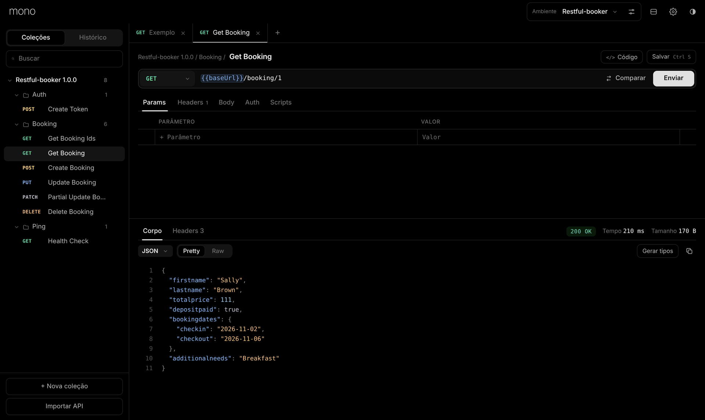

---

## Sumário

- [Por que o Mono](#por-que-o-mono)
- [Como o Mono foi feito](#como-o-mono-foi-feito)
- [Começando](#começando)
- [Recursos](#recursos)
  - [Importar uma API pela documentação](#importar-uma-api-pela-documentação)
  - [Visão geral da API, com diagramas](#visão-geral-da-api-com-diagramas)
  - [Variáveis e ambientes](#variáveis-e-ambientes)
  - [Workspaces](#workspaces)
  - [Trabalhar em equipe](#trabalhar-em-equipe)
  - [Histórico, comentários e presença](#histórico-comentários-e-presença)
  - [Monitores](#monitores)
  - [Conta e segurança](#conta-e-segurança)
  - [Cofre de segredos do time](#cofre-de-segredos-do-time)
  - [Scripts e testes (API pm.* do Postman)](#scripts-e-testes-api-pm-do-postman)
  - [Collection Runner com CSV](#collection-runner-com-csv)
  - [Fluxos visuais](#fluxos-visuais)
  - [Comparar ambientes](#comparar-ambientes)
  - [Respostas guardadas: hoje × ontem](#respostas-guardadas-hoje--ontem)
  - [Gerar tipos e gerar código](#gerar-tipos-e-gerar-código)
  - [Corpo da requisição](#corpo-da-requisição)
  - [GraphQL, WebSocket e SSE](#graphql-websocket-e-sse)
  - [Exemplos salvos e mock server](#exemplos-salvos-e-mock-server)
  - [Busca global (Ctrl + K)](#busca-global-ctrl--k)
  - [Testes gerados](#testes-gerados)
  - [Cookies](#cookies)
  - [Coleções no Git](#coleções-no-git)
  - [SOAP, SEFAZ e certificado digital](#soap-sefaz-e-certificado-digital)
  - [Assinatura digital de XML](#assinatura-digital-de-xml)
  - [Trava de produção](#trava-de-produção)
  - [Proxy corporativo, temas e o resto](#proxy-corporativo-temas-e-o-resto)
- [Atalhos](#atalhos)
- [Desenvolvimento](#desenvolvimento)
- [Servidor do Mono (equipe)](#servidor-do-mono-equipe)
- [Publicar uma versão](#publicar-uma-versão)
- [Arquitetura e segurança](#arquitetura-e-segurança)

---

## Por que o Mono

| | Postman | Mono |
|---|---|---|
| Conta e nuvem | Login obrigatório para a maioria dos recursos | Funciona sem conta. Com conta, só os workspaces que você compartilhar vão para o servidor |
| Importar API | OpenAPI e coleções | OpenAPI, Swagger UI, Redoc, apiDoc, Postman, **WSDL** e texto livre (com IA) |
| Entender uma API nova | Ler a documentação | **Visão geral** gerada: para que serve, como usar, diagramas e variáveis |
| SOAP | Corpo cru, sem WSDL | **Importa WSDL** e monta os envelopes; modelos da SEFAZ |
| Certificado A1 (.pfx) | Por host, sem suporte a .pfx antigos | Por host, inclusive `.pfx` antigos (RC2) exportados pelo Windows |
| Assinar XML (NF-e, eventos) | Não tem | **XMLDSig** no padrão fiscal, no botão ou por script |
| Workspaces | Na nuvem, ligados à conta | Locais ou **compartilhados por @**, com mudanças em tempo real |
| Ambientes | Variáveis | Variáveis, **comparação lado a lado** e **trava de produção** |
| Tipos e código | Snippets de código | Snippets + **records C# / TypeScript / Zod** a partir da resposta |
| Contrato | — | Avisa quando a resposta **muda de estrutura** ou foge do OpenAPI |

---

## Como o Mono foi feito

O Mono nasceu de uma **engenharia reversa do Postman feita com o REA**. O app do Postman foi analisado para entender como ele funciona por dentro, e as partes foram reimplementadas no Mono com código próprio: o formato das coleções, a API de scripts `pm.*`, o fluxo de variáveis e ambientes e a experiência de uso. Por isso o Mono importa e exporta coleções do Postman e roda os mesmos scripts. Por cima disso, ganhou o que faltava no dia a dia: SOAP com WSDL, certificado A1, assinatura de XML, trava de produção e visão geral de APIs.

---

## Começando

### Instalar

1. Baixe o `Mono-Setup-x.y.z.exe` em [Releases](https://github.com/jordaoluiz/mono/releases/latest).
2. Execute. Como o instalador ainda não é assinado digitalmente, o Windows SmartScreen pode avisar: clique em **Mais informações › Executar assim mesmo**.
3. O Mono cria atalhos no menu Iniciar e na área de trabalho e se atualiza sozinho quando sai uma versão nova.

### Primeira requisição em 1 minuto

1. Clique em **Importar API** (rodapé da barra lateral) e cole `https://restful-booker.herokuapp.com/apidoc/index.html`.
2. O Mono monta a coleção, cria o ambiente com `{{baseUrl}}` e abre a visão geral da API.
3. Abra **Auth › Create Token** e clique em **Enviar** (`Ctrl+Enter`). O token vai sozinho para `{{token}}`.
4. As requisições protegidas já usam o token. É só enviar.

---

## Recursos

### Importar uma API pela documentação

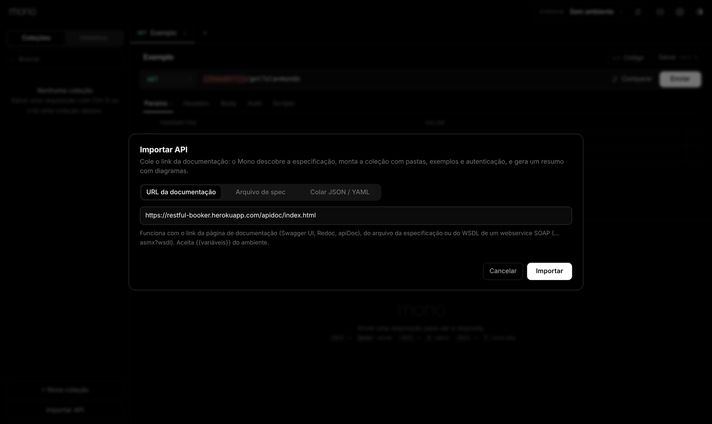

O **Importar API** aceita o link da documentação, um arquivo ou o conteúdo colado, e descobre sozinho onde está a especificação:

- **OpenAPI 3 / Swagger 2** (JSON ou YAML), páginas **Swagger UI** e **Redoc**, e caminhos comuns como `/v3/api-docs` e `/swagger.json`;
- **apiDoc** (`api_data.json`);
- **WSDL** de webservices SOAP (`…/servico.asmx`, `…?wsdl`, `.svc`);
- **coleções do Postman** (arquivo, link de coleção, documentação publicada ou workspace público) e exportações do Mono;
- documentação em **texto livre**, lida com IA (Claude ou ChatGPT, com a sua chave em *Configurações › IA*).

O resultado é uma coleção com uma pasta por grupo, bodies de exemplo, autenticação configurada e um ambiente com as variáveis. Endpoints de login ganham um script que guarda o token no ambiente.

### Visão geral da API, com diagramas

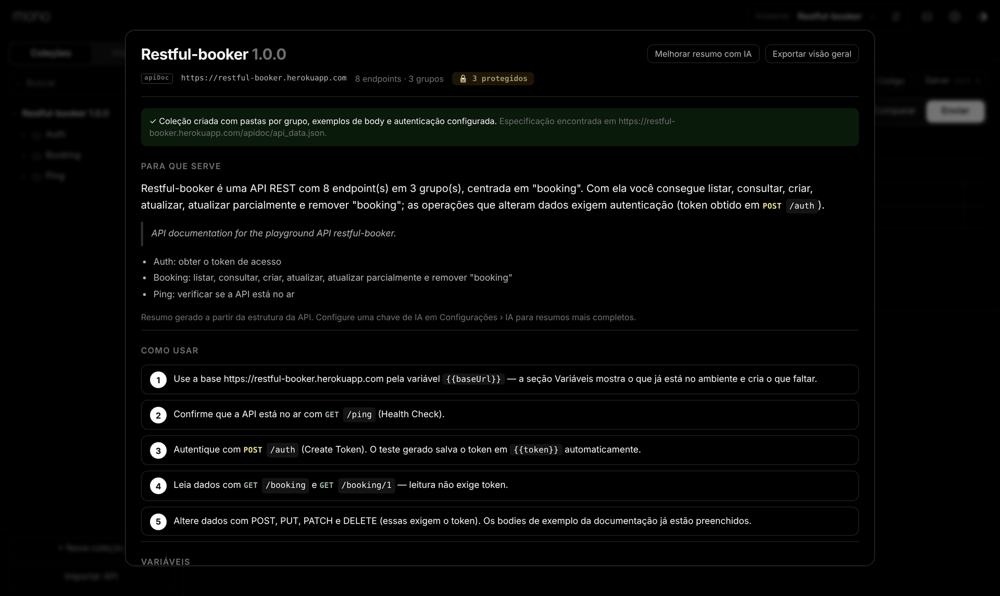

Cada API importada ganha uma **Visão geral** (ícone de livro na coleção):

- para que a API serve e o que dá para fazer com ela;
- passo a passo de uso e como autenticar;
- **diagrama de comunicação** e **fluxo típico** (diagrama de sequência);
- tabela de endpoints (um clique abre a requisição);
- variáveis que a coleção usa, com botão para **criá-las no ambiente**;
- relatório da importação: origem, o que foi criado e onde o Mono procurou.

Exporta em HTML ou Markdown, e cada diagrama copia como SVG.

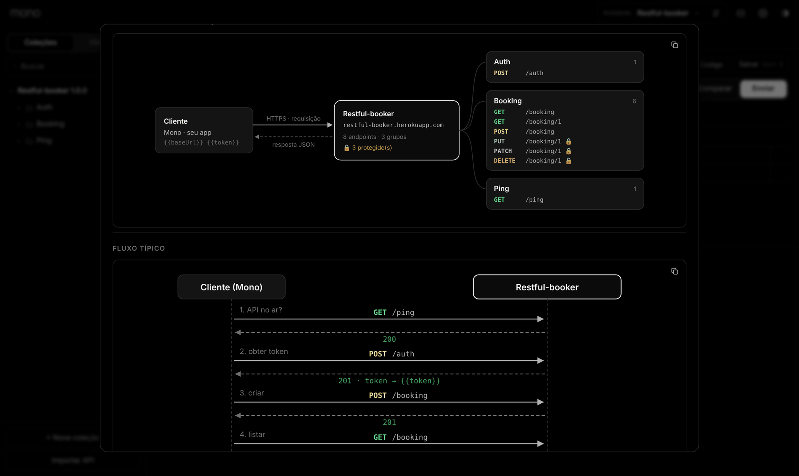

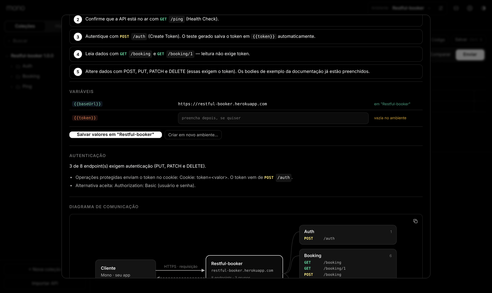

### Variáveis e ambientes

`{{variáveis}}` aparecem em **azul** quando existem e em **vermelho** quando não existem. Passe o mouse para ver o valor, ou clique para editar ou criar a variável no ambiente, na coleção ou nas globais.

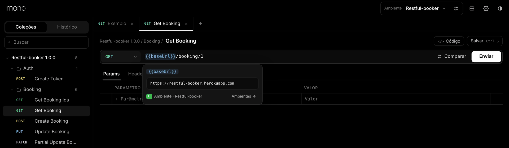

Ao digitar `{{` na URL, nos params ou nos headers, abre o autocompletar com o escopo e o valor de cada variável. `{{$guid}}`, `{{$timestamp}}`, `{{$randomInt}}` e outras variáveis dinâmicas aparecem com `{{$`.

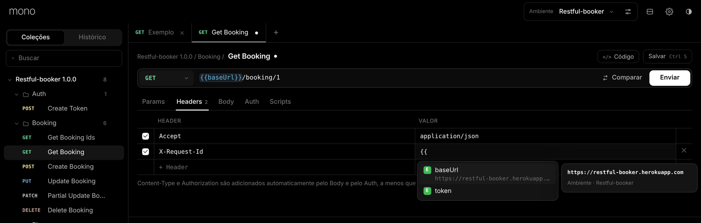

- **Escopos:** globais › coleção › ambiente › variáveis do script (a mais específica vence).
- **Segredos:** variáveis marcadas como segredo (cadeado) são criptografadas no disco pelo Windows (DPAPI) e nunca vão para exportações.

### Workspaces

Separe projetos e clientes em **workspaces**. O seletor fica no topo, ao lado do logo. Cada workspace tem as próprias coleções, ambientes, variáveis globais, histórico e abas abertas. Configurações (proxy, certificados, IA) e o tema valem para todos.

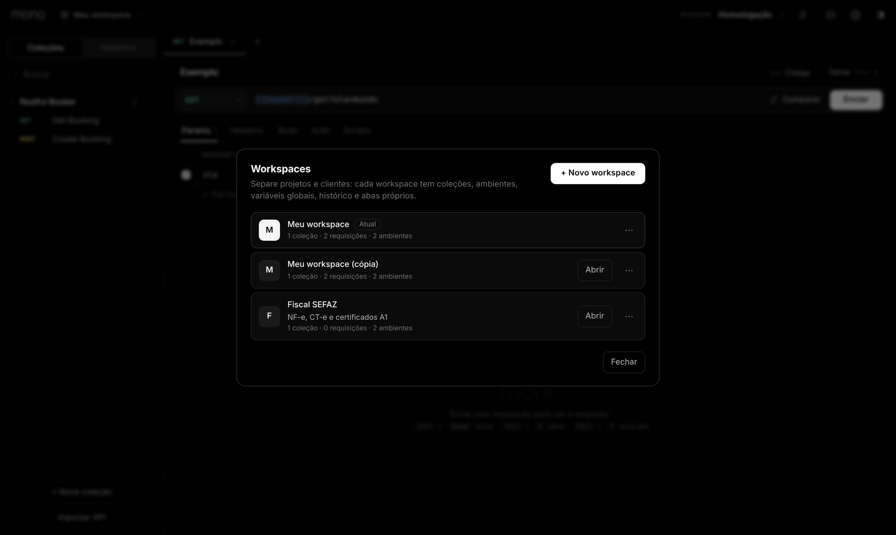

- **Criar:** em *+ Novo workspace*, com nome, descrição e a opção de copiar os ambientes e as globais do workspace atual.
- **Gerenciar:** abrir, renomear, duplicar (sem o histórico) e excluir.
- **Trocar:** a troca não perde nada. As abas com alterações não salvas continuam lá quando você volta.

### Trabalhar em equipe

Crie uma conta com um **@ único** e compartilhe um workspace. Para convidar, digite o @ da pessoa (o Mono sugere enquanto você digita). O convite chega na hora, com um aviso no seletor de workspace. Quem aceita vê o workspace no próprio Mono, e a partir daí **as mudanças de um aparecem para o outro em tempo real**: coleções, pastas, requisições salvas, ambientes e variáveis globais.

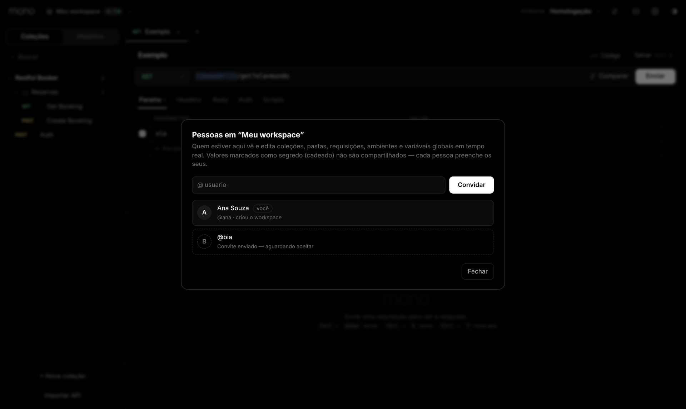

- **O que sincroniza:** o que está salvo. O rascunho de uma aba só vai quando você salva (Ctrl+S). Se o colega estiver com a mesma requisição aberta sem alterações, a aba dele atualiza sozinha.
- **O que não sai do seu computador:** valores marcados como segredo (cadeado), histórico, abas abertas e a árvore aberta ou fechada.
- **Conflitos:** cada item é gravado separado, então duas pessoas editando requisições diferentes não se atrapalham. Na mesma requisição, vale a última gravação.
- **Sem internet:** você continua trabalhando, e as mudanças vão quando a conexão volta.
- **Permissões:** ao convidar, escolha entre **pode editar** e **só leitura**. Quem tem só leitura vê tudo, envia as requisições e comenta, mas não altera o workspace. Quem criou o workspace muda o acesso das pessoas, remove pessoas e pode excluí-lo para todos. Quem sai ou é removido fica com uma cópia local.

### Histórico, comentários e presença

**Histórico com desfazer:** cada alteração fica registrada com quem fez e quando, como "@bia alterou Create Booking" ou "@ana excluiu Consulta". Clique numa alteração para ver o que mudou, com a URL antiga e a nova lado a lado. Use **Desfazer** para voltar ao valor anterior para todos, inclusive para recuperar algo excluído por engano. Abra pelo menu do workspace ou pelo menu de uma requisição, que mostra só o histórico dela.

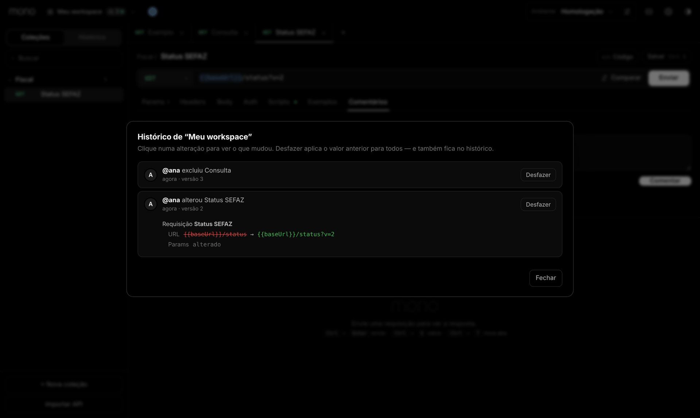

**Comentários:** a aba **Comentários** da requisição guarda notas do time, como "esse endpoint muda em novembro". Dá para resolver, editar e apagar. A árvore mostra quantos comentários estão em aberto.

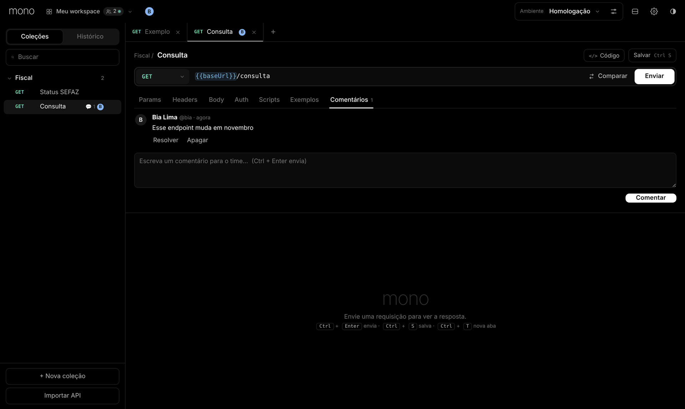

**Presença:** os avatares no topo mostram quem está no workspace agora. Na árvore e nas abas, aparece quem está com cada requisição aberta.

**Avatar:** em **Sua conta** (menu do workspace), escolha uma foto do computador ou a cor da inicial e o nome que os colegas veem. O Mono recorta e reduz a foto, e a mudança aparece na hora para todo mundo que divide workspace com você.

### Monitores

Um monitor roda uma coleção ou pasta de tempos em tempos (a cada 5 minutos, 15 minutos, 1 hora…) e avisa com uma notificação do Windows quando algo falha e quando volta. Um exemplo é o status da SEFAZ a cada 15 minutos.

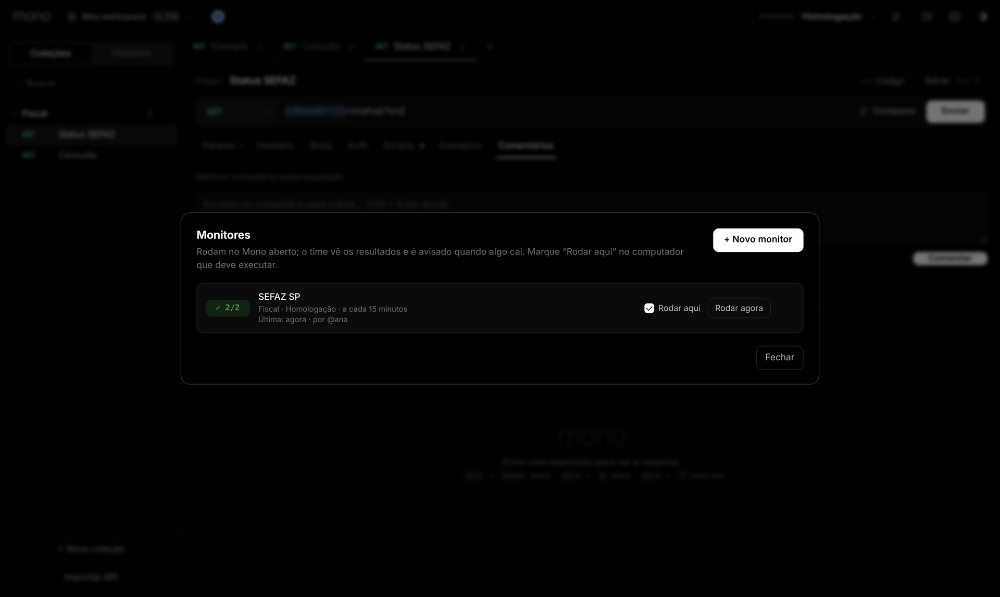

- **Onde roda:** no Mono aberto deste computador. Assim o monitor usa o seu certificado A1 e os seus segredos, que nunca vão para o servidor. Marque **Rodar aqui** no computador que deve executar.
- **No time:** em workspace compartilhado, o resultado vai para todos, como "SEFAZ SP falhou (rodado por @luiz)", com o histórico das últimas execuções.
- **O que conta como falha:** erro de rede, erro em script ou `pm.test` que não passou. Coloque testes na aba Scripts para checar o conteúdo da resposta.
- **Onde criar:** pelo menu do workspace (**Monitores…**) ou pelo menu da coleção ou pasta (**Monitorar…**).

### Scripts e testes (API pm.* do Postman)

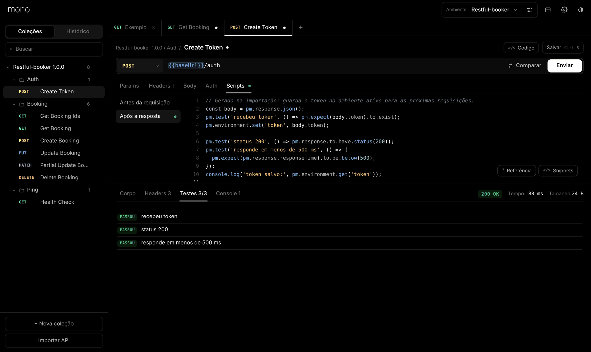

A aba **Scripts** tem *Antes da requisição* e *Após a resposta*, com a mesma API do Postman: `pm.test`, `pm.expect` (estilo Chai), `pm.environment`, `pm.collectionVariables`, `pm.globals`, `pm.variables`, `pm.request` (alterável antes do envio), `pm.response`, `pm.sendRequest`, `pm.cookies`, `pm.visualizer` e `pm.execution`.

- O editor tem números de linha, cores, autocompletar de `pm.` e `Ctrl+/` para comentar.
- **Snippets** prontos e uma **Referência** da API ficam no canto do editor.
- Coleções e pastas também têm scripts. A ordem de execução é coleção › pastas › requisição.
- Os resultados aparecem nas abas **Testes**, **Console** e **Visualizar** da resposta. Erro no script mostra a linha.
- Os scripts rodam isolados num Web Worker, sem acesso ao app nem aos seus arquivos.

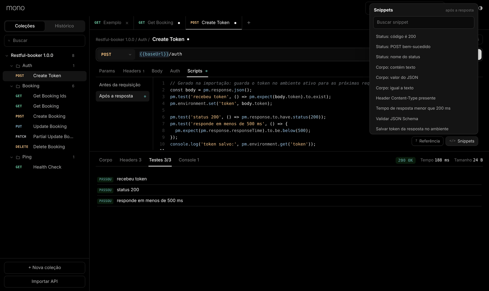

### Collection Runner com CSV

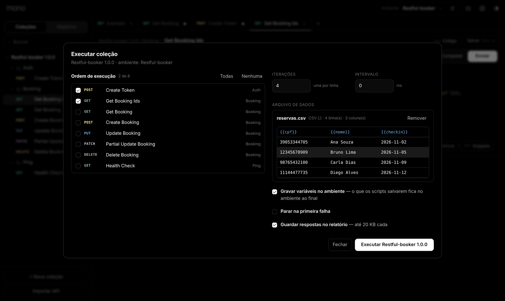

Menu ⋯ da coleção › **Executar coleção** (ou de uma pasta). Escolha as requisições, a ordem, as iterações e um **arquivo de dados** CSV (aceita `;` do Excel) ou JSON. Cada linha vira uma iteração e cada coluna vira `{{variável}}` e `pm.iterationData`.

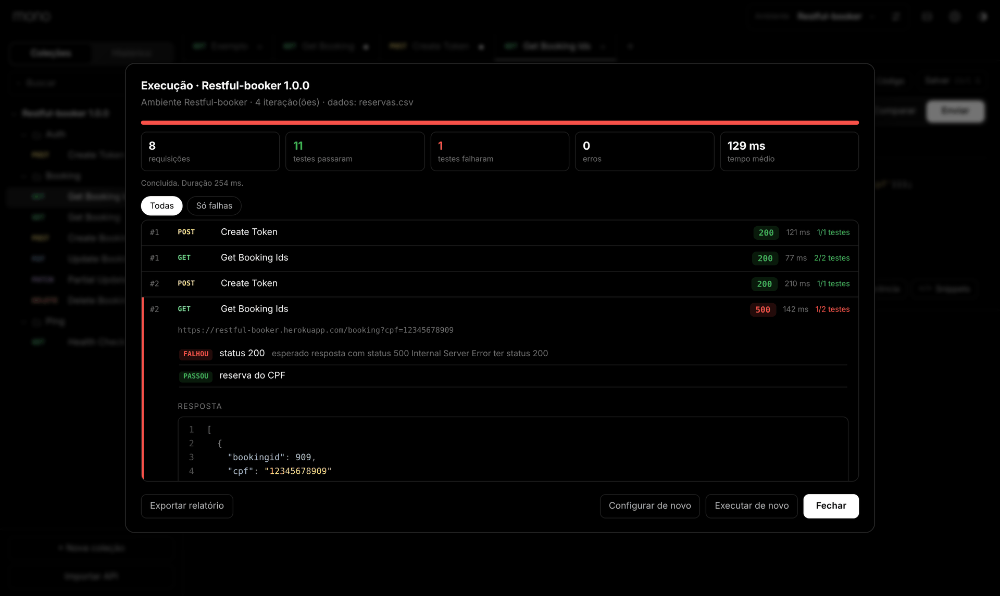

- O resultado mostra requisições, testes que passaram e falharam, erros e tempo médio, com filtro "Só falhas".
- Clicando numa linha aparecem os testes, o console e a resposta.
- `pm.execution.setNextRequest()` muda a ordem da execução.
- O relatório exporta em HTML ou JSON.

### Fluxos visuais

Na aba **Fluxos** da barra lateral, você monta um fluxo de requisições num quadro, sem escrever script. Por exemplo: login → criar pedido → para cada item, consultar → avisar se faltar estoque.

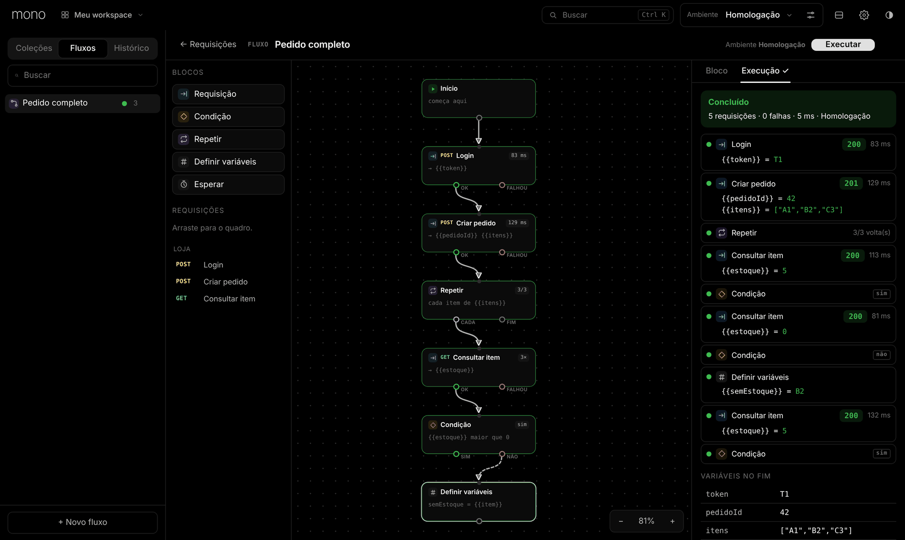

1. **Montar:** arraste as requisições da coleção para o quadro, na ordem. Cada uma já se liga à anterior. Para ligar à mão, arraste a bolinha de baixo de um bloco até o próximo. Clicar na bolinha desfaz a ligação.
2. **Passar valores:** em **Guardar da resposta**, cada valor da resposta vira uma variável: `token` vem de `access_token`, `pedidoId` vem de `id`. Pode ser JSON, XML (`cStat`, `protNFe/nProt`), header, status ou regex. Também dá para escolher o campo clicando, em **Escolher da última resposta…**. Nas próximas requisições, é só usar `{{token}}` na URL, nos headers, no corpo ou na autorização.
3. **Decidir e repetir:**
   - **Condição** segue por *sim* ou *não*. Por exemplo: `{{res.status}}` é igual a 200, ou `{{estoque}}` maior que 0.
   - **Repetir** roda N vezes, para cada item de uma lista ou enquanto uma condição valer. Ex.: consultar o recibo da SEFAZ a cada 2 s até `{{cStat}}` ser 100, no máximo 20 vezes.
   - **Definir variáveis** e **Esperar** completam os blocos.
4. **Executar:** o fluxo roda no ambiente ativo, com os scripts, testes, autorização, cookies e certificado de cada requisição. Os blocos acendem conforme rodam, e o painel mostra cada passo, os valores guardados e a resposta.

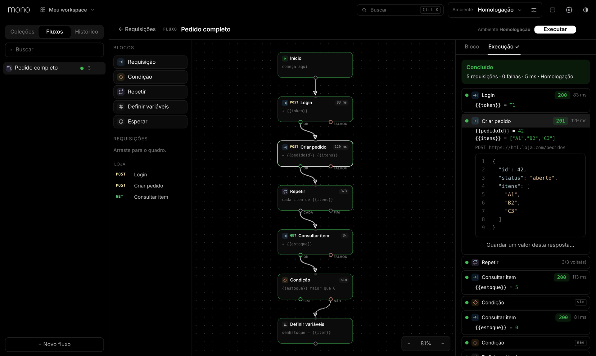

**Falhas:** um erro de rede, um teste reprovado ou um status 4xx/5xx contam como falha (o status pode deixar de contar). Se a saída **falhou** de uma requisição estiver ligada, o fluxo segue por ela. Se não estiver, o fluxo para ali e mostra o bloco em vermelho. Em produção, o Mono pede confirmação antes de rodar requisições que alteram dados.

**No time:** os fluxos ficam no workspace e sincronizam com o time, como as coleções. Cada pessoa executa no próprio Mono.

**Atalhos:** Ctrl + Enter executa, Delete apaga o bloco ou a ligação selecionada e Esc volta às requisições. Arraste o fundo para mover o quadro e use Ctrl + roda para o zoom.

### Comparar ambientes

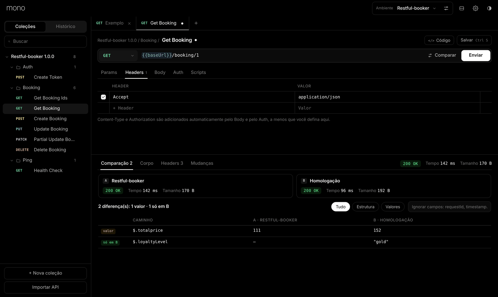

O botão **Comparar** envia a mesma requisição para dois ambientes ao mesmo tempo (ex.: produção × homologação) e mostra lado a lado o status, o tempo e cada diferença no JSON: valor, tipo, campo que só existe de um lado. Dá para ignorar campos voláteis como `timestamp`.

O Mono também guarda a estrutura da última resposta de cada endpoint e avisa em **Mudanças** quando aparece campo novo, some um campo ou muda um tipo. Com OpenAPI, a resposta é validada contra o contrato (selo **Contrato**).

### Respostas guardadas: hoje × ontem

Cada envio guarda a resposta no seu computador, cifrada pelo Windows: até 20 por requisição, junto com o ambiente e o horário. A aba **Respostas** da resposta lista todas e compara duas delas campo a campo, com a mesma tela do Comparar:

- **Atual × anterior:** o que mudou na API desde o último envio, ou desde ontem.
- **Homologação × Produção:** compara a última resposta de cada ambiente, sem enviar de novo.
- **Duas quaisquer:** marque duas na lista e clique em **Comparar as 2 marcadas**.

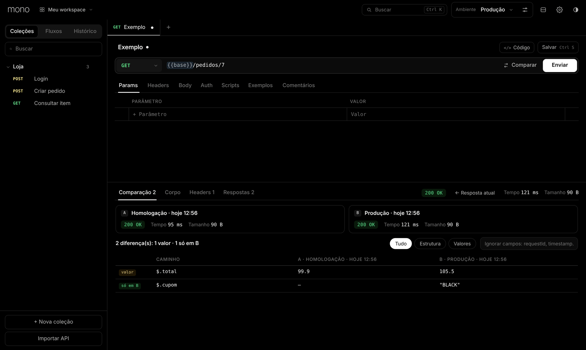

Use **Fixar como referência** para guardar uma resposta "boa" que não sai da lista, e dê um nome a ela, como "antes da versão 2.3". As respostas não vão para o servidor nem para o time. Para desligar, vá em **Configurações › Requisições**.

### Gerar tipos e gerar código

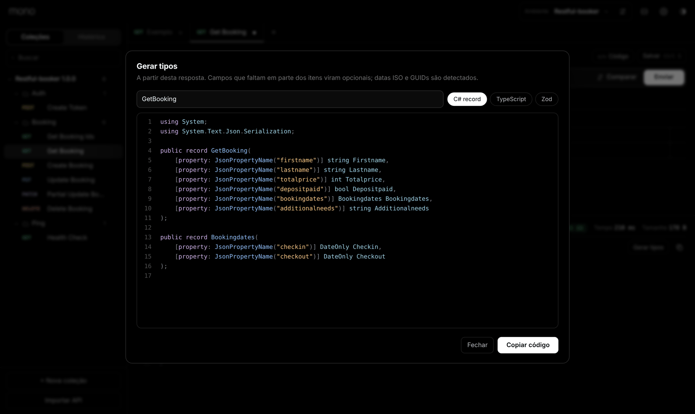

**Gerar tipos** transforma a resposta JSON em `record` C# (com `JsonPropertyName`), `interface` TypeScript ou schema Zod. Detecta campos opcionais, nulos, datas ISO e GUIDs.

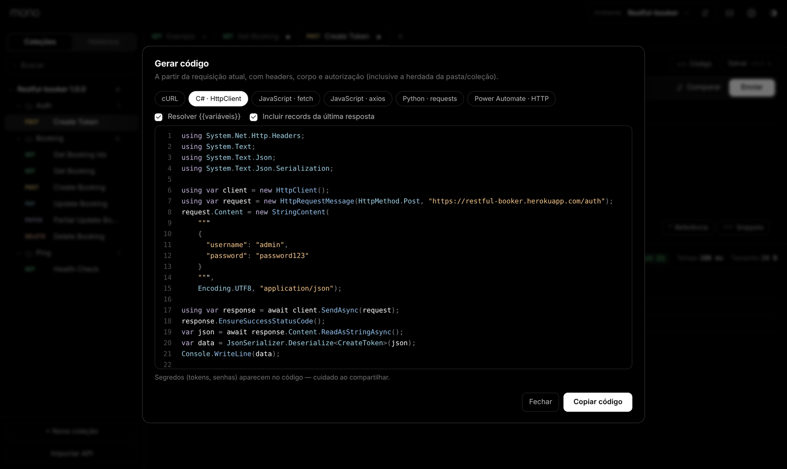

**</> Código** gera a requisição em **cURL, C# (HttpClient), JavaScript (fetch e axios), Python (requests) e Power Automate** (ação HTTP).

- Inclui headers, corpo (até form-data e arquivos), a autorização herdada da pasta ou coleção e o certificado digital do host.
- No C#, pode incluir os records da última resposta e desserializar direto neles.

### Corpo da requisição

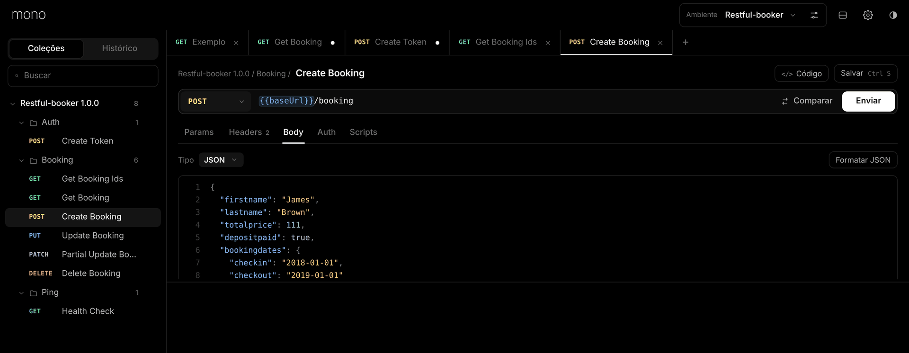

O seletor de tipo oferece JSON, XML / SOAP, texto, **form-data** (campos e arquivos), x-www-form-urlencoded e **binário** (um arquivo como corpo). O editor é o mesmo dos scripts, com linhas e cores.

Arquivos são lidos na hora do envio, e só os que você escolheu na janela do Windows. Uma coleção importada não consegue fazer o app enviar outros arquivos do seu computador.

### Conta e segurança

Ao criar a conta, o Mono mostra **10 códigos de recuperação**. O Mono não usa e-mail, então eles são a forma de entrar se você esquecer a senha. Cada código vale uma vez, e dá para gerar novos quando quiser.

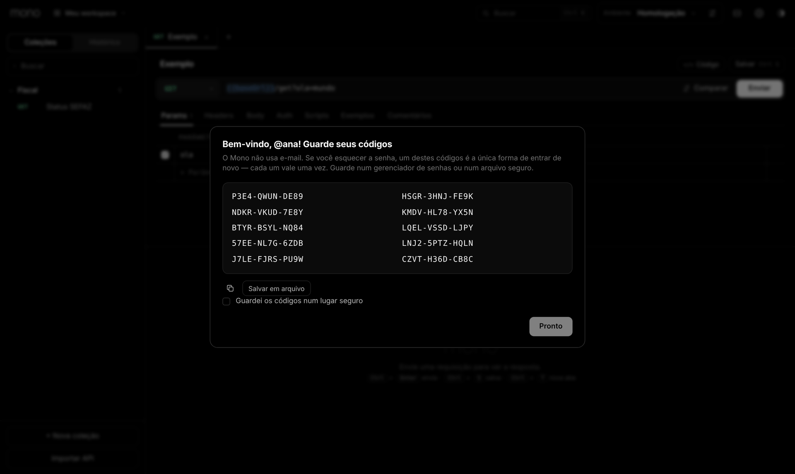

Em **Sua conta**:
- **Trocar senha:** as outras sessões são encerradas.
- **Códigos de recuperação:** mostra quantos restam e gera novos.
- **Onde estou conectado:** lista cada computador e o último uso, com **Encerrar** e **Sair de todos os outros**. O Mono daquele computador sai da conta na hora. Útil se perder o notebook.
- **Esqueci a senha:** na tela de entrar, use o @, um código e a nova senha.

### Cofre de segredos do time

Em **Pessoas e convites**, ligue o **Cofre de segredos**. A partir daí, os valores com cadeado (tokens, senhas, chaves) vão para o time **cifrados de ponta a ponta**: o servidor guarda, mas não consegue ler. Quando alguém troca um segredo, os outros recebem o valor novo na hora.

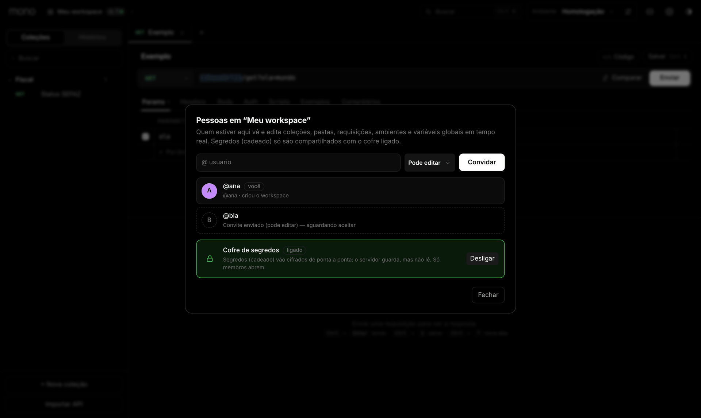

- **Chaves de cada pessoa:** cada uma tem um par de chaves próprio, criado no cadastro. A chave privada fica no computador, cifrada pelo Windows. Para entrar em outro computador, um backup dela cifrado com a sua senha fica no servidor.
- **Chave do workspace:** cada workspace tem uma chave (AES-256), entregue a cada membro embrulhada com a chave pública dele. Quem entra depois recebe a chave automaticamente de um colega.
- **Saída de alguém:** quem criou o workspace gera uma chave nova automaticamente, e quem saiu não abre os segredos novos.
- **Ao recuperar a conta com um código:** o Mono cria uma chave nova, e os colegas entregam a chave do cofre de novo.

### GraphQL, WebSocket e SSE

**GraphQL:** no Body, escolha **GraphQL**. A tela fica dividida em query e variáveis (JSON). **Buscar schema** carrega o schema da API por introspecção, usando a mesma URL, headers e autenticação. Depois disso o editor sugere campos e argumentos no ponto certo da query, com o tipo de cada um. Com mais de uma operação, escolha qual executar.

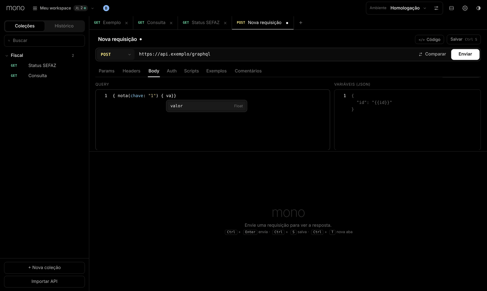

**WebSocket e SSE:** no seletor de método, escolha **WS** (WebSocket) ou **SSE** (Server-Sent Events). O botão vira **Conectar**/**Desconectar**, e a resposta vira um registro das mensagens:
- cada mensagem mostra direção, horário, tamanho e evento;
- clique numa mensagem para ver o JSON formatado;
- dá para filtrar as mensagens.

No WebSocket, a aba **Mensagem** envia texto ou JSON com `{{variáveis}}` (Ctrl+Enter) e guarda mensagens prontas. Headers, auth, proxy e certificado A1 funcionam como nas requisições HTTP.

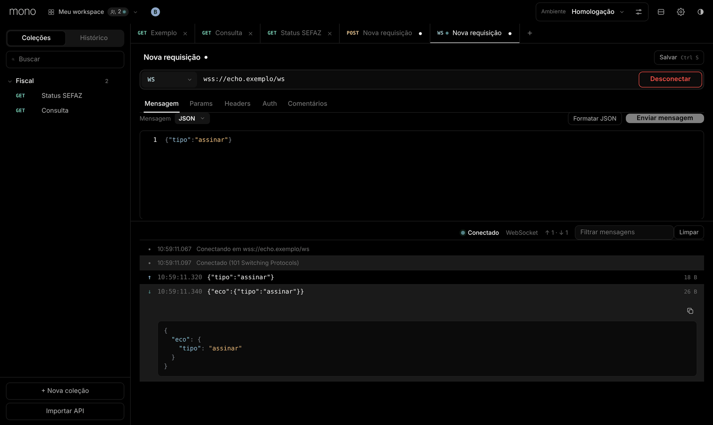

### Exemplos salvos e mock server

Na resposta, **Salvar como exemplo** guarda o status, os headers e o corpo na requisição, na aba **Exemplos**. Os exemplos documentam a API, vão junto na exportação para o Postman e alimentam o **mock server**.

No menu da coleção, **Mock server…** sobe uma API falsa em `http://127.0.0.1:4010`, montada com os exemplos, e o front pode trabalhar antes do back ficar pronto:
- reconhece rotas com `{{id}}`, `:id` e `{id}`;
- libera CORS;
- dá para configurar um atraso nas respostas;
- mostra as chamadas recebidas;
- para escolher um exemplo específico, use o header `x-mono-example`.

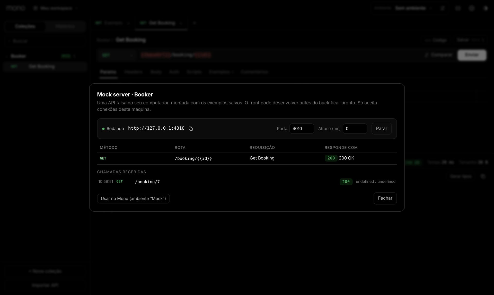

### Busca global (Ctrl + K)

**Ctrl + K** (ou o campo **Buscar** no topo) acha qualquer coisa: requisições (por nome, URL ou método), coleções, pastas, ambientes, variáveis e workspaces, inclusive de outros workspaces. Também dá acesso às ações do app (monitores, cookies, configurações…). Use as setas para navegar e Enter para abrir.

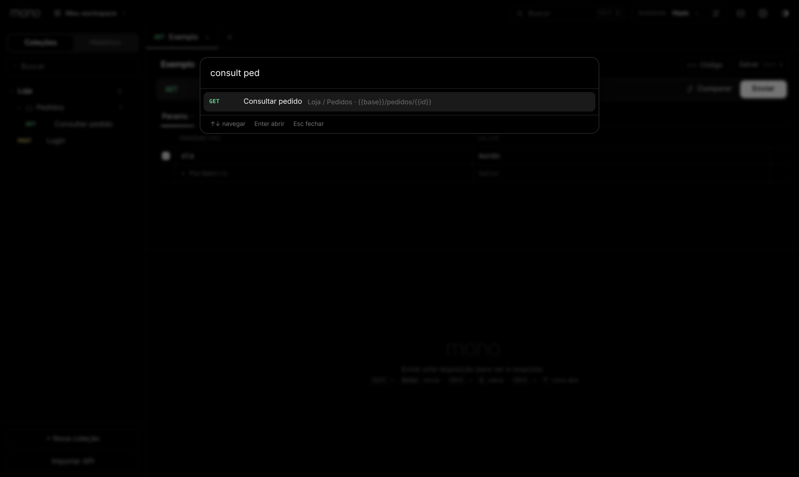

### Testes gerados

Na resposta, **Gerar testes ▾** escreve os `pm.test` a partir do que voltou:
- **Testes básicos:** status, tempo, Content-Type, campos obrigatórios e tipos do JSON, até dois níveis.
- **Com IA (Claude ou ChatGPT):** também formatos e regras de negócio, como datas, CPF/CNPJ, chave de NF-e e valores não negativos.

Você revisa no editor e escolhe **Adicionar** ou **Adicionar e rodar**. É o par ideal dos monitores, que só pegam erro de conteúdo quando existem testes.

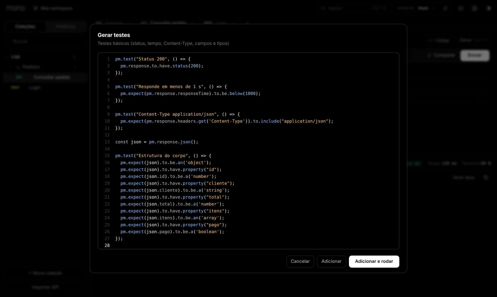

### Cookies

O Mono guarda o `Set-Cookie` das respostas e manda o `Cookie` nas próximas requisições para o mesmo domínio, respeitando Path, Domain, Secure e validade. Um header `Cookie` escrito à mão vence. Em **Cookies…** (menu do workspace ou Ctrl + K) você vê, edita e apaga os cookies por domínio, ou desliga o comportamento automático. Os cookies ficam por workspace, só no seu computador.

### Coleções no Git

No menu da coleção, **Salvar como arquivos (Git)…** vincula a coleção a uma pasta do seu repositório:

```
mono.collection.json              ← nome, auth, variáveis (sem segredos), scripts, pastas e ordem
pedidos/consultar-pedido.req.json ← uma requisição por arquivo
login.req.json
```

- **Gravação automática:** a cada mudança, o Mono grava só o que mudou, com o JSON sempre no mesmo formato, para os diffs ficarem limpos. Commit e push ficam por sua conta.
- **Mudanças por fora:** quando os arquivos mudam por fora (`git pull`, troca de branch), a coleção recarrega sozinha.
- **Abrir de uma pasta:** **Abrir coleção de uma pasta (Git)…** abre uma coleção que veio de um repositório.
- **O que fica fora dos arquivos:** segredos e o caminho da pasta, que é só deste computador.

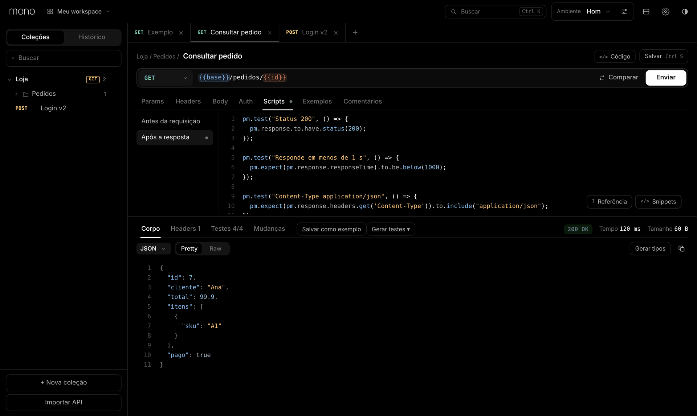

### SOAP, SEFAZ e certificado digital

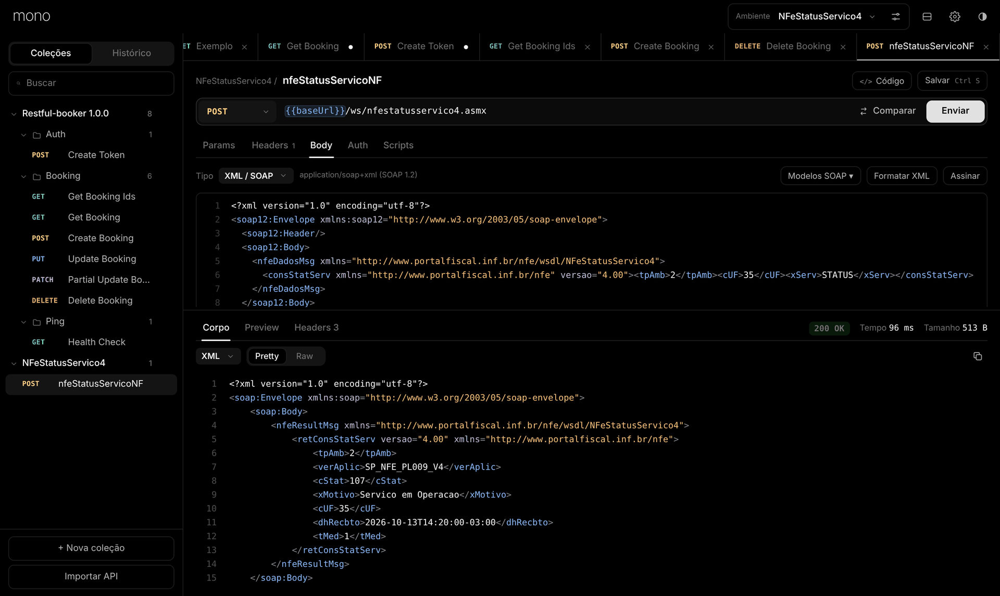

- **Importar WSDL:** cole o link do `.asmx`. O Mono busca o `?wsdl` e os XSD, cria uma requisição por operação e monta o envelope (SOAP 1.1 ou 1.2) com Content-Type e SOAPAction certos.
- **Mensagens da NF-e:** nos serviços da NF-e 4.00 (status, consulta de protocolo, eventos, inutilização, cadastro, autorização), o corpo já vem com a mensagem de exemplo.
- **Modelos SOAP:** envelopes 1.1 e 1.2 e o *Status do Serviço* da SEFAZ ficam no botão **Modelos SOAP** do Body.

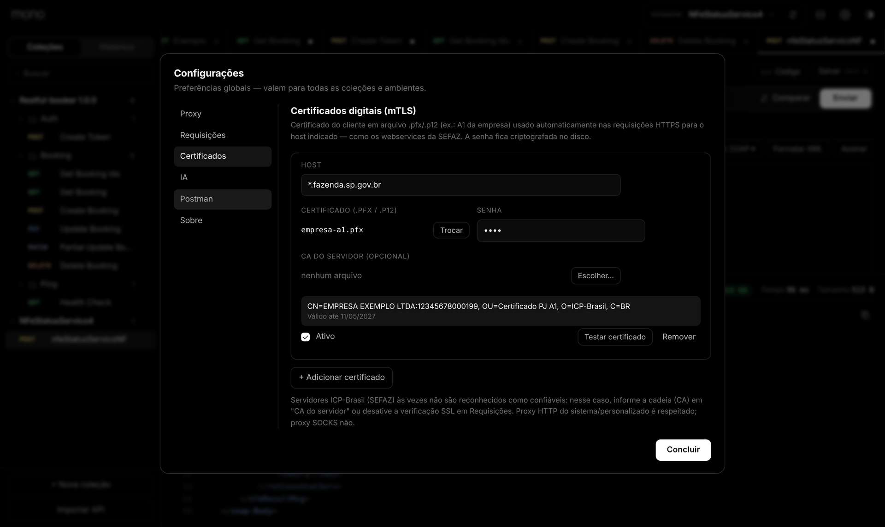

Em **Configurações › Certificados**, cadastre o `.pfx` (A1) para um host, como `*.fazenda.sp.gov.br`. As requisições HTTPS para ele usam o certificado automaticamente (mTLS), inclusive o download do WSDL.

- Mostra o titular e a validade, com aviso perto do vencimento. A senha fica criptografada.
- Lê `.pfx` modernos (AES), 3DES e os antigos com RC2, comuns em certificados exportados pelo Windows.
- "CA do servidor" serve para cadeias ICP-Brasil que não forem reconhecidas.
- Funciona atrás do proxy HTTP da empresa.

### Assinatura digital de XML

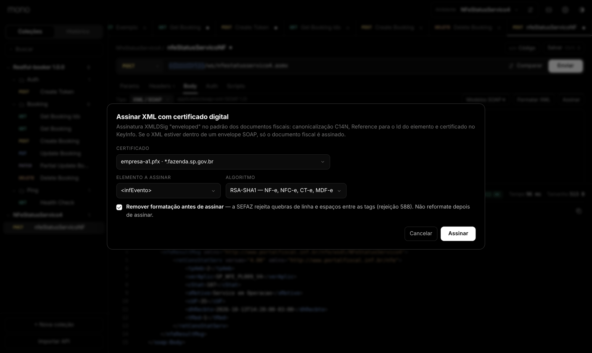

O botão **Assinar** (Body do tipo XML) aplica a assinatura **XMLDSig enveloped** no padrão dos documentos fiscais: C14N, `Reference URI="#Id"` e certificado no `KeyInfo`.

- **Algoritmo:** RSA-SHA1 para NF-e, NFC-e, CT-e e MDF-e; RSA-SHA256 para eSocial, Reinf e algumas NFS-e.
- **Elemento:** o Mono sugere o elemento a assinar (`infNFe`, `infEvento`, `infInut`…) e assina todos os do lote.
- **Formatação:** é removida antes de assinar, porque a SEFAZ rejeita quebras de linha entre as tags.
- **Envelope SOAP:** quando o XML está dentro dele, só o documento fiscal entra na assinatura.
- **Verificar** confere as assinaturas.
- **Por script:** `await pm.xml.sign(pm.request.body.raw, 'infEvento')` assina antes de cada envio.

### Trava de produção

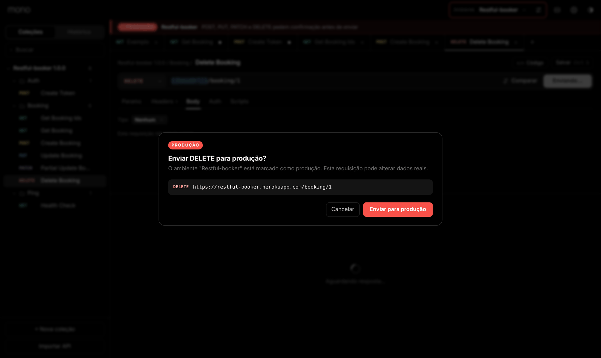

Marque um ambiente como **produção**. O app mostra uma faixa de aviso, e POST, PUT, PATCH e DELETE pedem confirmação com a URL final. Vale também para o Runner.

### Proxy corporativo, temas e o resto

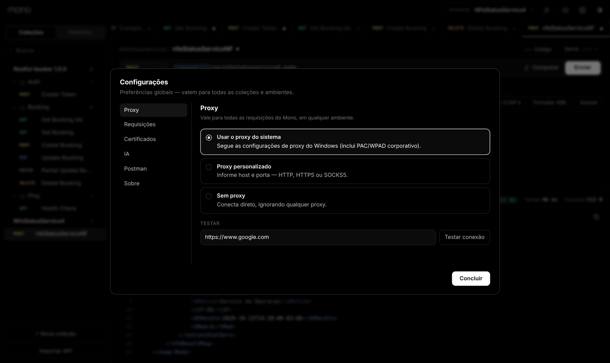

- **Proxy:** do sistema (PAC/WPAD), personalizado (HTTP, HTTPS, SOCKS5, com usuário e senha) ou nenhum, com botão de teste.
- **Requisições:** tempo limite, redirecionamentos e verificação SSL.
- **Autorização** no padrão do Postman: herdar do pai, Bearer, Basic, API Key e OAuth 2.0 (client credentials e password, com renovação automática). Coleções e pastas têm a própria autorização.
- **Organização:** pastas e subpastas com arrastar e soltar, histórico por dia e abas.
- **Exportar:** coleção no formato Mono, Postman v2.1 ou OpenAPI. Segredos nunca são exportados.
- **Resposta:** *Pretty* e *Raw* com detecção de linguagem (JSON, HTML, XML…), **Preview** de HTML e imagens, e resposta embaixo ou ao lado.
- **cURL:** colar um `curl` na barra de URL monta a requisição.
- **Temas:** escuro, claro e azul.

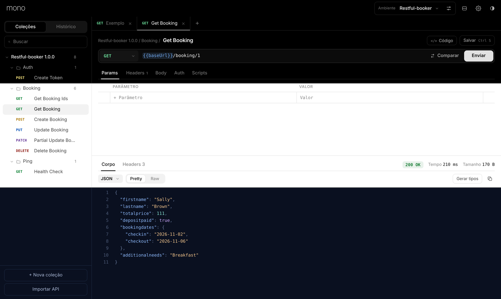

---

## Atalhos

| Atalho | Ação |
|---|---|
| `Ctrl+Enter` | Enviar |
| `Ctrl+S` | Salvar requisição |
| `Ctrl+T` / `Ctrl+W` | Nova aba / fechar aba |
| `Ctrl+Alt+L` | Resposta embaixo ou ao lado |
| `{{` | Autocompletar variáveis |
| `Ctrl+Espaço` | Autocompletar no editor de scripts |
| `Ctrl+/` | Comentar linhas no editor |

---

## Desenvolvimento

Requisitos: Windows, [Node.js](https://nodejs.org) 20+ e Git.

```powershell
git clone https://github.com/jordaoluiz/mono.git
cd mono
npm.cmd install
npm.cmd run dev
```

`npm run dev` liga o **hot reload**: mudanças na interface recarregam a janela (CSS sem recarregar) e mudanças no processo principal reiniciam o app.

| Comando | O que faz |
|---|---|
| `npm.cmd start` | Abre o app |
| `npm.cmd run dev` | Abre com hot reload |
| `npm.cmd test` | Roda os testes (HTTP, scripts, importação, WSDL, assinatura, certificados…) |
| `npm.cmd run dist` | Gera o instalador em `dist\Mono-Setup-<versão>.exe` |

> No PowerShell use `npm.cmd`/`npx.cmd`: a política de execução padrão bloqueia os atalhos `.ps1`.

### Estrutura

```
src/
  main.js            processo principal: janela, IPC, arquivos, IA
  http.js            monta e envia requisições (body, auth, multipart…)
  network.js         sessão do Chromium com proxy e SSL
  certs.js           mTLS com .pfx (A1) e túnel pelo proxy
  pkcs12.js rc2.js   leitura de .pfx (inclusive RC2)
  xmlsign.js         assinatura XMLDSig
  updater.js         atualização automática
  store.js           dados em disco, segredos via safeStorage
  cloud.js           conexão com o servidor do Mono (API + eventos em tempo real)
  preload.js         ponte mínima entre interface e processo principal
  shared/            módulos sem dependências, usados na interface, no servidor e nos testes
                     (OpenAPI, apiDoc, Postman, WSDL, XML/C14N, scripts pm.*, codegen, runner…)
  renderer/          interface (HTML, CSS do design system, editor de scripts, variáveis)
server/              servidor do Mono: contas, workspaces compartilhados, convites, SSE
test/                testes em Node, sem frameworks
```

O visual segue o design system descrito em [`DESIGN-SYSTEM.md`](DESIGN-SYSTEM.md).

---

## Servidor do Mono (equipe)

O app não fala com o banco de dados. Ele fala com o **servidor do Mono** (`server/`), e só o servidor tem a string do MongoDB, numa variável de ambiente. Assim ninguém consegue tirar a senha do banco de dentro do instalador.

**Rodar no seu computador** (para testar):

```powershell
cd server
copy .env.example .env      # cole a MONGODB_URI do Atlas no .env (ele não vai para o Git)
npm.cmd install
npm.cmd run dev             # http://localhost:8787
```

**Publicar no Railway** (recomendado, configurado em [`railway.json`](railway.json) + [`Dockerfile`](Dockerfile)):

1. No [Railway](https://railway.com), escolha **New Project → Deploy from GitHub repo** e selecione este repositório.
2. Em **Variables**, adicione `MONGODB_URI` (e, se quiser, `MONGODB_DB=mono`).
3. Em **Settings → Networking**, clique em **Generate Domain**.
4. No Atlas, em **Network Access**, libere `0.0.0.0/0`, porque o Railway não tem IP fixo no plano Hobby.
5. Coloque o domínio gerado em `MONO_CLOUD_URL` (`src/renderer/app.js`). O servidor oficial já está configurado: `https://mono-server-production.up.railway.app`.

Mantenha **1 réplica**: os eventos em tempo real ficam na memória do servidor.

**Publicar no Render** (alternativa, configurado em [`render.yaml`](render.yaml)):

1. No [Render](https://render.com), escolha **New → Blueprint** e aponte para este repositório.
2. Preencha `MONGODB_URI` quando o Render pedir.
3. No Atlas, em **Network Access**, libere o acesso do servidor. No plano gratuito do Render o IP muda, então use `0.0.0.0/0`. A senha continua protegendo o banco.
4. Use a URL do serviço (`https://mono-server-xxxx.onrender.com`) no campo **Servidor** da tela de conta, ou deixe-a como padrão em `MONO_CLOUD_URL` (`src/renderer/app.js`).

**Segurança:**
- **Senhas:** guardadas com scrypt.
- **Sessões:** o app recebe um token de sessão (180 dias), guardado criptografado pelo Windows.
- **Acesso aos workspaces:** só membros leem ou alteram um workspace.
- **Validação:** o servidor confere cada alteração antes de gravar.
- **Força bruta:** login e cadastro têm limite de tentativas.

---

## Publicar uma versão

```powershell
npm.cmd version patch      # 0.1.1 → 0.1.2, cria o commit e a tag
git push --follow-tags
```

O GitHub Actions (`.github/workflows/release.yml`) roda os testes, gera o instalador e publica em [Releases](https://github.com/jordaoluiz/mono/releases). Os apps instalados procuram atualização ao abrir e a cada 4 horas, baixam em segundo plano e mostram o botão **Atualizar** no topo. *Configurações › Sobre* mostra a versão e procura na hora.

---

## Arquitetura e segurança

- **Requisições no processo principal:** sem CORS. Saem por uma sessão própria do Chromium que respeita proxy e SSL. Hosts com certificado A1 usam o `https` do Node.
- **Interface isolada:** `contextIsolation` e `sandbox: true`, ponte `contextBridge` com funções explícitas, checagem do remetente em todo IPC e CSP restrita.
- **Scripts:** rodam num Web Worker sem acesso ao app. `pm.sendRequest` e `pm.xml.sign` passam por funções controladas.
- **Preview de HTML:** usa um protocolo próprio (`mono-preview://`) com scripts e formulários bloqueados.
- **Cofre do time:** com o cofre ligado, segredos compartilhados vão cifrados de ponta a ponta (ECDH P-256 + AES-256-GCM). O servidor nunca vê a senha, a chave privada nem os valores.
- **Segredos:** variáveis de segredo (de todos os workspaces), senhas de proxy e de certificado e chaves de IA ficam criptografadas com o `safeStorage` (DPAPI no Windows).
- **Arquivos:** só são lidos os que você escolheu na janela do sistema. Coleções importadas não apontam para arquivos do seu computador.
- **Dados:** ficam em `%APPDATA%\Mono\mono-data.json`. Só vão para o servidor do Mono os workspaces que você compartilhar, sem os segredos.

---

<p align="center"><sub>Feito por <a href="https://github.com/jordaoluiz">Luiz Jordão</a> · MIT</sub></p>
